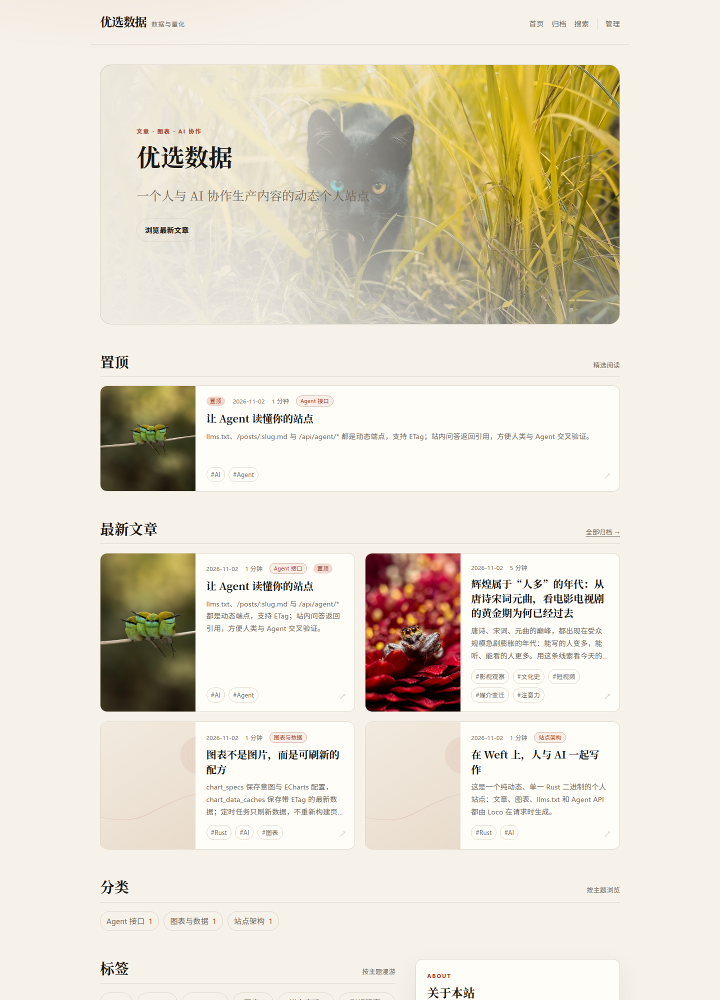
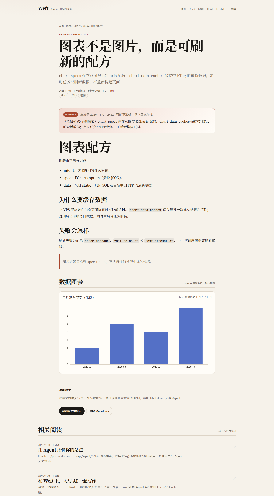
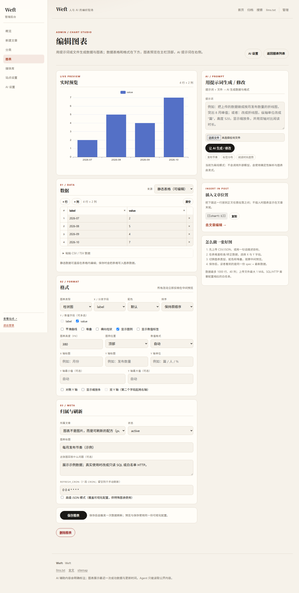
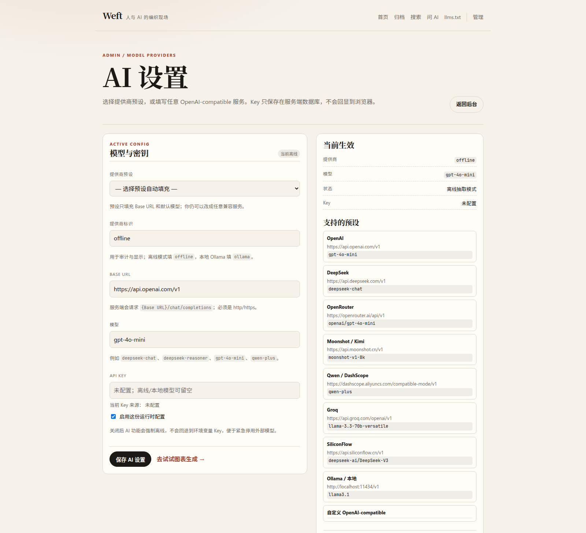
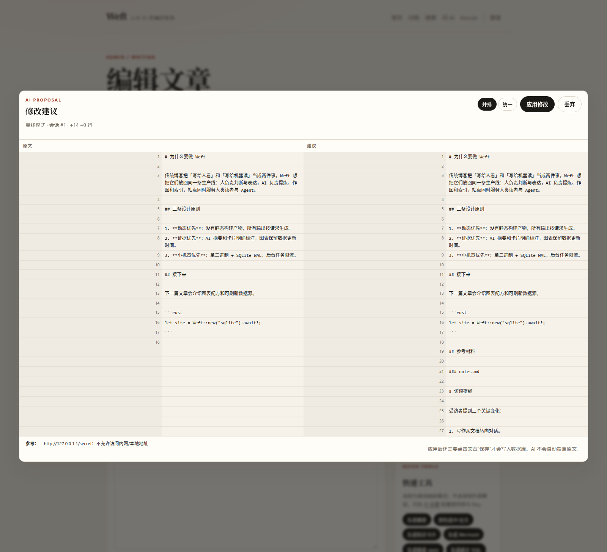

# Weft

Weft 是一个 **AI 原生个人站点**：人类写作，AI 辅助编辑、作图、分类和索引，站点以人类读者为主。它不是静态站点生成器——首页、文章、Markdown、`llms.txt`、图表数据与 Agent API 都由 Loco 服务端在请求时生成。

- 单一 Rust 二进制 + SQLite（WAL）
- Loco 1.2 / Axum 0.8 / SeaORM 2
- 服务端 Tera 模板 + 少量原生 JS + 本地 ECharts
- 后台 Worker + Loco Scheduler
- 无 Node 构建链、无 SPA、无 Redis / 消息队列











## 实现状态（M0–M5）

| 里程碑 | 状态 | 关键交付 |
|---|---|---|
| M0 | 完成 | Loco 1.2 骨架、SQLite WAL、健康检查、动态首页/文章页 |
| M1 | 完成 | posts/tags、管理员 cookie 登录、CRUD/状态流转、`.md`/`llms.txt` |
| M2 | 完成 | chart_specs/cache/recipes、图表 API、ECharts、static/sql/http 适配器、可提示词/文件的 Chart Studio、可视化数据与格式、AI 可改图表细节、高级 JSON 实时预览 |
| M3 | 完成 | 5 个 Worker、Loco Scheduler、cron 到期刷新、退避/重试、发布触发 |
| M4 | 完成 | ai_sessions、意图驱动的 AI 文章编辑/从零创作 + 材料/网页引用 + diff 应用、多提供商 AI 设置页（DeepSeek 等） |
| M5 | 完成 | Agent API、ETag/Last-Modified、缓存、限流/token、README、集成测试 |

最终验证：`cargo fmt --all -- --check`、`cargo clippy --all-targets -- -D warnings`、`cargo test` 全部通过；集成测试使用离线 AI，不访问外网。

## 快速开始

要求：Rust stable、`loco` 生成器（仅用于生成脚手架，运行已有仓库不强制）、`sea-orm-cli`（只在重新生成实体时需要）。

```bash
# 1. 编译并初始化数据库（SQLite 默认文件：weft_development.sqlite）
cargo loco db migrate

# 2. 创建唯一的站点管理员（邮箱需与 settings.site.admin_email 一致）
cargo loco task admin:create \
  email:admin@example.com \
  name:"Admin" \
  password:"change-me-12345"

# 3. 可选：写入三篇示例文章、标签、分块索引和一个 ECharts 图表
cargo loco task demo:seed

# 4. 启动
cargo loco start
# http://localhost:5150
```

### 为什么 `cargo loco task` 会先编译

本仓库的 `.cargo/config.toml` 定义了：

```toml
[alias]
loco = "run --"
```

所以：

```bash
cargo loco task db:backup
# 等价于
cargo run -- task db:backup
```

Rust 的 task 不是独立脚本，而是同一个 `weft-cli` 二进制里的子命令。`cargo run` 每次都会先检查二进制是否需要更新：

- 代码没变：通常只显示 `Finished ... in 0.xxs`，不会真正编译；
- 代码、迁移或 Cargo 依赖变了：会先编译，然后执行 task，这是正常行为。

如果希望 task 完全不经过 `cargo run`，先构建一次，之后直接运行二进制：

```bash
cargo build --bin weft-cli
target/debug/weft-cli task db:backup

# 或者用包装脚本：源文件比二进制新时才构建
./scripts/weft task db:backup
```

生产环境可以直接用 release 二进制，不依赖 Rust 工具链：

```bash
target/release/weft-cli task db:backup
```

如果**代码完全没变**但每次都看到 `Compiling weft`，检查：

```bash
echo "$CARGO_HOME $RUSTFLAGS"
cargo build --bin weft-cli # 连续跑两次，第二次应不再编译
```

常见原因是切换了 `CARGO_HOME`、`RUSTFLAGS`、target 目录或 feature 组合，而不是 task 本身。

### 站点设置

登录后台后打开：

```text
/admin/settings/site
```

可修改：

- 站点名称
- 品牌名（留空回退到站点名称）
- 品牌副标题
- 站点描述
- 作者
- 站点 URL
- 每页文章数

设置保存在 `site_settings` 表，运行时覆盖 `config/<env>.yaml` 中的默认值，保存后立即生效，不需要重启。环境变量 `SITE_TITLE` / `SITE_BRAND` / `SITE_TAGLINE` / `SITE_DESCRIPTION` / `SITE_AUTHOR` / `SITE_BASE_URL` 仍可作为首次启动或数据库为空时的默认值。

### 日常开发不需要重建数据库

上面的初始化只需做 **一次**。之后修改 Rust 代码、模板、CSS/JS 都**不需要**删除数据库或重建管理员：

```bash
# 推荐：先备份，再启动；数据库缺失/为空时会拒绝启动，不会静默创建空库
./scripts/start-dev.sh

# 或者直接启动（auto_migrate=true 会自动应用未执行的迁移）
cargo loco start
```

- 默认数据库是稳定的 `weft_development.sqlite`，文章、用户、图表、Key 都在里面。
- 当前项目尚未对外发布，迁移已压缩为一个初始化基线 `m20261103_000000_init`；之后新增结构变更再追加迁移，迁移是增量的，不会清空已有数据。
- `config/test.yaml` 里的 `dangerously_recreate: true` 只作用于测试数据库；测试库路径已硬编码为 `weft_test.sqlite`，不再读取 `DATABASE_URL`，避免 shell 里的开发库 URL 把测试重建打到开发库上。
- `cargo test` 每次重建的是隔离的测试库，不是开发库。
- 清理测试库请用 `./scripts/clean-test-db.sh`，不要用 `rm weft_*.sqlite` 这类通配符。
- 不要执行 `rm weft_development.sqlite`、`rm weft_*.sqlite`、`cargo loco db reset` 或切换 `DATABASE_URL`，除非你确实想从空库开始。
- 首次初始化数据库时可以直接 `cargo loco db migrate`；之后日常启动建议用 `./scripts/start-dev.sh`。
- 忘记管理员密码时不要重建用户，直接重置：

```bash
cargo loco task admin:reset \
  email:admin@example.com \
  password:"new-strong-password"
```

- 如果 `admin:create` 提示用户已存在，这是正常的；用 `admin:reset`。
- 做迁移前、或任何清理动作前建议备份。项目内置了一致性备份任务（SQLite `VACUUM INTO`，兼容 WAL）：

```bash
cargo loco task db:backup
# 默认写入 backups/weft-YYYYmmdd-HHMMSS.sqlite
# 也可以指定：
cargo loco task db:backup path:backups/before-migration.sqlite
```

- 恢复时先停止服务，再把备份复制回数据库文件，并删除旧的 `-wal`/`-shm`：

```bash
# 先停止 cargo loco start
cp backups/before-migration.sqlite weft_development.sqlite
rm -f weft_development.sqlite-wal weft_development.sqlite-shm
```

- `backups/` 已加入 `.gitignore`，不会提交；建议再复制到另一块磁盘或对象存储。

> 本项目开发和验收时反复出现 `rm ...sqlite`、`db migrate`、`admin:create`，是因为我在用临时数据库做隔离测试并主动清理测试产物；这不是运行项目的必需步骤。

后台操作（开发环境默认 `workers.mode: BackgroundAsync`）：

```bash
# 定时刷新图表 + 补偿未完成的索引 + 清理过期缓存
SCHEDULER_CONFIG=config/scheduler.yaml cargo loco start --all

# 或独立运行 scheduler（适合 systemd）
SCHEDULER_CONFIG=config/scheduler.yaml cargo loco scheduler --config config/scheduler.yaml
```

> Scheduler 触发时会同步执行任务（而不是在任务进程里 `perform_later` 后立刻退出），因此刷新不会因为短生命周期进程而丢失。Web 请求仍然只把发布任务交给 Worker。

## 环境变量与配置

所有配置在 `config/<env>.yaml`，密钥通过 `get_env(...)` 插值；应用代码不直接读 `std::env`。

| 变量 | 默认 / 必填 | 用途 |
|---|---|---|
| `LOCO_ENV` | `development` | `development` / `test` / `production` |
| `DATABASE_URL` | development 默认 `weft_development.sqlite`；production 必填 | 如 `sqlite://weft.sqlite?mode=rwc`；测试库不使用此变量 |
| `JWT_SECRET` | production 必填 | 管理员 cookie 的 JWT 签名密钥 |
| `ADMIN_EMAIL` | `admin@example.com` | 唯一允许登录 `/admin` 的邮箱 |
| `SITE_BASE_URL` | `http://localhost:5150` | 生成 llms.txt、sitemap、Agent API 绝对链接 |
| `SITE_THEME` | `default` | 主题目录：`themes/<name>/templates` + `themes/<name>/static`，修改后重启 |
| `SITE_TITLE` | `Weft` | 站点标题（文章 `<title>`、首页主标题） |
| `SITE_BRAND` | 空（回退到 `SITE_TITLE`） | 页头品牌名，例如 `My Notes` |
| `SITE_TAGLINE` | `人与 AI 的编织现场` | 页头品牌副标题 |
| `SITE_DESCRIPTION` | 站内文案 | SEO / 首页描述 |
| `SITE_AUTHOR` | `Weft` | 作者署名 |
| `OPENAI_API_KEY` | 空 | 环境变量默认 Key；也可在 `/admin/settings/ai` 配置数据库 Key（优先） |
| `AI_PROVIDER` | `offline` | `offline` 或 `deepseek` / `openai` / `ollama` 等；运行时配置优先 |
| `OPENAI_BASE_URL` | `https://api.openai.com/v1` | OpenAI-compatible API 根路径 |
| `AI_MODEL` | `gpt-4o-mini` | 图表/文章编辑模型 |
| `AI_DAILY_COST_LIMIT_USD` | `1.0` | 24 小时成本估算上限；超过后拒绝新调用 |
| `AI_ARTICLE_MAX_OUTPUT_TOKENS` | `4000` | 文章编辑/从零创作的输出上限；其他后台任务仍用 `max_output_tokens` |
| `AGENT_API_TOKEN` | 空 | 为空时 `/api/agent/*` 公开；设置后要求 Bearer token |
| `AGENT_RATE_LIMIT_PER_MIN` | `30` | 每个 token/匿名的 Agent 读请求限额 |
| `DB_MAX_CONNECTIONS` | dev 4 / prod 5 | SQLite 连接池保守上限 |

### AI 运行模式

- **离线模式（默认）**：不访问网络，返回确定性的图表 spec 与草稿框架；方便本地运行和 CI。
- **真实模型**：可以在 `/admin/settings/ai` 中配置提供商预设、Base URL、模型和 API Key；也可以继续用环境变量 `OPENAI_API_KEY` / `AI_PROVIDER` / `OPENAI_BASE_URL` / `AI_MODEL` 作为默认值。数据库中的运行时配置优先于环境变量；Key 只保存在服务端，页面只显示“已配置/未配置”，不回显 Key。
- 支持的预设包括 OpenAI、DeepSeek、OpenRouter、Moonshot/Kimi、Qwen/DashScope、Groq、SiliconFlow 和本地 Ollama；也可以填任意 OpenAI-compatible 服务。
- 所有调用经过超时、并发信号量、24h 成本门禁和 `ai_sessions` 审计。
- **公开 AI 端点已移除**：站点访客不会触发任何模型调用；AI 仅限登录后台的文章编辑、图表工作室、AI 设置和发布后的后台 Worker。Agent API 只读，不提供 `ask`。
- LLM 只被允许生成受控 JSON/文本。图表 spec 会做 JSON 对象与大小校验；SQL 会做只读 + 表白名单校验；任何模型生成的代码都不会被执行。

## 功能地图

### 公开阅读端

- `/` 首页：置顶、最新文章、标签、开放阅读
- `/posts/:slug` 文章页：Markdown 渲染、标题只显示一次、不重复摘要、相关阅读、阅读进度、按 chart_id 动态加载图表；正文开头重复标题会自动在渲染时去掉
- `/posts/:slug.md` 动态 Markdown（含 front matter、正文）
- `/tags/:slug`、`/archive`、`/search?q=...`
- `/llms.txt`、`/llms-full.txt`：动态内容地图、文章清单、Agent API、更新策略
- `/sitemap.xml`、`/robots.txt`
- `GET /api/charts/:id/data`：`{spec,data,updated_at,etag,stale}`，支持 ETag / 304

### 管理端

- `/admin/login`：密码登录，JWT 写入 `HttpOnly; SameSite=Strict` cookie；只允许 `ADMIN_EMAIL`
- `/admin`：文章/图表/AI 会话概览
- `/admin/settings/site`：站点名称、品牌名、副标题、描述、作者、首页 Banner、站点 URL、每页文章数；Banner 可直接上传图片或填写 URL，留空使用默认横幅；保存后立即生效
- `/admin/settings/ai`：AI 提供商、Base URL、模型与 Key；支持 DeepSeek / OpenAI / OpenRouter / Moonshot / Qwen / Groq / SiliconFlow / Ollama 预设
- `/admin/posts/new`、`/admin/posts/:id/edit`：Markdown 编辑、标签、草稿/审核/发布流转
- AI 文章编辑面板：提示词 + 上传材料 + 网页参考，返回完整修订稿并在 diff 中确认；不再提供无上下文的“一键生成摘要/卡片/Mermaid/SQL/代码”按钮。摘要仍由作者直接填写
- `/admin/charts`：图表列表、手动刷新、cron、失败退避状态
- **AI 自动分类**：管理端一键读取全站文章生成分类并归类，无需手工维护分类；文章列表和分类页自动展示
- **左侧管理菜单**：概览、文章、新建文章、分类、图表、媒体库、站点设置、AI 设置；中文排版优先，标题字号收敛
- **文章管理**：`/admin/posts` 统一管理文章
- **读者优先的公开页面**：主导航只保留首页、归档、搜索和管理；不再展示 llms.txt/Agent API 入口，Agent 仍可通过 `/llms.txt`、`/sitemap.xml` 自行发现站点
- **文章列表封面**：首页、标签、分类、搜索、归档显示封面；没有封面时使用中性默认封面
- **媒体选择器**：文章编辑页从已上传媒体中按缩略图选择，支持按文件名搜索和图片/视频筛选；媒体可重复使用
- **媒体库**：后台可直接上传图片和短小视频；图片自动插入 Markdown，视频使用 `[[video:文件名]]` 标记，封面图也可从本机上传；默认限制图片 8 MB、视频 12 MB
- **宽屏管理后台**：管理页使用最大 1760px 的宽屏工作区，文章编辑页 AI 侧栏 380–460px，窄屏自动堆叠；阅读页仍保持 1080px 正文宽度
- **AI 文章编辑 / 从零创作（Diff First）**：提示词 + 多文件材料（Markdown/TXT/HTML/PDF/DOCX/CSV/JSON）+ 最多 5 个公开网页链接；可修改现有正文，也可在正文为空时直接创作标题、摘要、标签和完整正文；AI 返回后在类 Copilot 的并排/统一 diff 中查看改动，点击“应用修改”后才写回编辑器，再手动保存数据库；不引入版本历史表
- **图表工作室（Chart Studio）**：用提示词 + CSV/TSV/JSON/Markdown/文本文件生成或修改图表；表格可视化编辑数据；图表类型/X/Y 字段/配色/排序/堆叠/平滑/横向/图例/标签/高度/轴标题/单位/数值格式/Y 轴范围/对数轴/缩放条/双轴全部可视化控制；也可以直接让 AI 改这些细节；主栏顶部 ECharts 大图预览，下面是数据与格式；高级 JSON 也支持实时预览，作为特殊图表兜底
- 发布动作：分块索引、刷新关联图表，并使 `llms.txt` 缓存失效
- 图表插入位置：在正文单独一行写 `[[chart:ID]]`，图表会渲染在任意段落；没有标记的图表仍显示在文末。文章编辑器的图表列表提供“插入正文”，图表工作室提供“复制插入标记”。

### Agent API（只读）

| 端点 | 说明 |
|---|---|
| `GET /api/agent/posts?since=RFC3339&limit=50` | 已发布文章清单，支持 ETag / Last-Modified |
| `GET /api/agent/posts/:slug` | 元数据 + Markdown + 卡片 + 图表引用 |
| `GET /api/agent/charts/:id` | 图表 spec + 最新数据 + ETag |

设置 `AGENT_API_TOKEN` 后，所有 Agent 请求需要：

```http
Authorization: Bearer <AGENT_API_TOKEN>
```

## 图表细节与 AI 修改

图表格式由受控的 `blueprint.options` 描述，当前包括：

```text
类型 / X 字段 / Y 字段 / 配色 / 排序
平滑 / 堆叠 / 横向 / 图例 / 数值标签
高度 / X 轴标题 / Y 轴标题 / Y 轴单位
数值格式（自动、整数、1 位小数、百分比、紧凑）
Y 轴 min/max / 对数轴 / 缩放条 / 图例位置 / 双 Y 轴
```

这些字段会同时进入 ECharts spec 和公开图表渲染；`_weft.height` / `_weft.number_format` / `_weft.y_unit` 用于前端高度与数值格式。

**AI 修改**：图表工作室右侧的提示词可以直接要求修改类型和细节；AI 返回的 `blueprint.options` 会更新控件和实时预览。高级 JSON 模式现在也会实时预览，并支持把 `data_source_config` 的数据注入 `dataset.source`，或保留 kline/sankey 等已经自带 `series.data` 的配置。

## AI 自动分类

后台：

```text
/admin/categories
```

点击“AI 重新分类全站文章”：

1. 读取全部文章标题、摘要和正文片段；
2. AI 生成 3–8 个可复用分类；
3. 每篇文章归入一个分类；
4. 覆盖旧分类，不修改文章正文；
5. 分类立即出现在首页、文章卡片、文章页和 `/categories/<slug>`。

离线模式会使用关键词规则生成分类；真实模型使用 AI 设置中的提供商。分类操作写入 `ai_sessions`，只允许登录后台执行。

## 媒体与视频

后台新增 **媒体库**：

```text
/admin/media
```

- 图片：JPG/PNG/WebP/GIF/AVIF，最大 8 MB
- 上传按文件内容识别类型，扩展名写错（例如 JPEG 存成 `.png`）也能正常入库
- 已上传媒体可以在文章编辑页点击“从媒体库选择”，按缩略图浏览、搜索文件名、筛选图片/视频，再插入正文或设为封面；不需要重新上传
- 视频：MP4/WebM，最大 12 MB
- 文件保存到 `media/uploads/`，公开地址 `/media/<filename>`
- 图片复制 Markdown 插入正文
- 视频复制 `[[video:<filename>]]`，单独一行插入正文
- 文章封面也可以直接上传并设置

视频不做转码，建议上传 H.264 MP4 或 WebM。个人服务器直接提供小体积视频，不依赖外部 CDN。

`media/uploads/` 是运行时持久数据，已加入 `.gitignore`；备份数据库时也要同步备份这个目录（或把它放到持久卷）。

## 首页 Banner

站点设置里新增：

```text
/admin/settings/site → 首页 Banner 图片
```

- 留空使用内置 `themes/default/static/hero-banner.svg`
- 可以填写外链 URL
- 可以直接上传图片，系统会保存到媒体库并填入 URL
- 也可以点“从媒体库选择”，用缩略图搜索并复用已上传图片
- 图片会覆盖整个首页 Hero，左侧叠加纸张色渐变保证文字可读；移动端改为底部渐变

自定义 Banner 提示词：

```text
wide editorial hero banner, warm off-white handmade paper, abstract woven threads,
vermilion and ink accents, soft natural light, minimal Chinese aesthetic,
large calm negative space on the left for headline text, no text, no logo,
21:9 or 2:1, high resolution
```

搜索关键词：`minimal paper texture banner`、`vermilion thread abstract`、`warm editorial abstract background`。

## 主题模板

前端已经从 Rust 代码中分离：

```text
themes/default/templates/  Tera 页面模板
themes/default/static/     CSS / JS / ECharts / 静态图片
```

复制并修改主题：

```bash
cp -a themes/default themes/mytheme
SITE_THEME=mytheme ./scripts/start-dev.sh
```

修改模板和 CSS 不需要编译 Rust；切换 `SITE_THEME` 需要重启。详见 [themes/README.md](themes/README.md)。

## 图表的插入位置

文章正文支持在**单独一行**插入图表标记：

```markdown
# 开头

前面的文字。

[[chart:3]]

## 后面的小节

后面的文字。
```

- 图表会直接渲染在标记位置，适合放在论证段落之间。
- 没有标记的图表仍会自动汇总到文章末尾的“数据图表”区域。
- 在文章编辑页右侧图表列表点击“插入正文”，会在光标处生成标记。
- 在图表工作室编辑已保存图表时，可复制 `[[chart:ID]]` 标记。

## 图表

管理端提供 **Chart Studio** 可视化编辑流程：

1. 输入提示词，可选上传 CSV/TSV/JSON/Markdown/文本文件；
2. AI 解析数据并生成/修改标题、图表类型、X/Y 字段和格式；
3. 在可编辑表格中直接修改/增删行列，或粘贴 CSV/TSV；
4. 用下拉框与开关调整类型、配色、排序、堆叠、平滑、横向、图例、标签；
5. 主栏顶部 ECharts 大图实时预览，下面是数据与格式；右侧是 AI 提示词。保存时服务端重新生成并校验受控 spec。

静态数据可直接在表格编辑；SQL/HTTP 数据源用普通输入框配置并在保存前拉取预览，保存后由后台按 cron 刷新。特殊图表（如 kline/sankey）仍可使用“高级 JSON 模式”。

图表不是图片，而是：

```
chart_specs（标题、意图、kind、数据源配置、ECharts option、refresh_cron）
       +
chart_data_caches（最近一次成功 payload、ETag、fetched_at、expires_at）
       ↓
GET /api/charts/:id/data → 前端 ECharts 渲染
```

### 数据源适配器

- **static**：可视化表格保存为 `{"data":[...],"columns":[...],"blueprint":{...}}`；也兼容旧的手工 `{"data":[...]}`。
- **sql**：`{"query":"SELECT label, value FROM posts ...","limit":200}`。
  - 仅允许单条 `SELECT`；
  - 禁止 `INSERT/UPDATE/DELETE/PRAGMA/ATTACH/...`、注释和多语句；
  - 所有 `FROM`/`JOIN` 表必须在 `settings.charts.sql_allowed_tables` 中；
  - 有超时与行数上限。
- **http**：`{"url":"https://...","method":"GET","data_path":"data.items"}`。
  - 域名必须在 `settings.charts.http_allowlist` 中（默认空，显式拒绝）；
  - 禁止私有/回环主机、URL 凭据；
  - 有连接超时、响应体大小上限、JSON 校验。
  - 股票 K 线等场景只需配置任意白名单供应商 URL，不硬编码供应商。

`refresh_cron` 使用 7 段 cron（秒 分 时 日 月 周 年），例如每天 04:00：

```yaml
refresh_cron: "0 0 4 * * * *"
```

`charts:refresh_due` 每分钟由 Loco Scheduler 调用，按每个图表的 cron 与 `last_run_at` 计算是否到期；失败写入 `error_message`、`failure_count`、`next_attempt_at`，按指数退避重试，达到 `settings.jobs.max_attempts` 后停止自动重试，可在管理端手动触发。

## 数据模型

迁移已按当前最终结构压成一个基线，位于 `migration/src/m20261103_000000_init.rs`：

- `posts`：slug、标题、作者摘要、Markdown、status、pinned、published_at、reading_minutes
- `tags` / `post_tags`
- `ai_sessions`：purpose、provider、model、messages、tool_calls、status、token/成本估算、错误
- `ai_settings`：管理端保存的运行时提供商、Base URL、模型、Key 与启用状态（Key 存服务端数据库，不回显）
- `site_settings`：管理端保存的站点名称、品牌、副标题、描述、作者、首页 Banner、URL 和每页文章数；启动时加载到运行时缓存，保存后立即生效
- `media`：本地上传图片/视频的元数据；文件位于 `media/uploads/`，公开路径 `/media/<filename>`
- `categories`：AI 生成的分类；`posts.category_id` 关联文章
- `chart_specs`：意图、kind、数据源配置、render_config、cron、最后成功/失败、退避
- `chart_data_caches`：payload、ETag、获取时间、过期时间（chart_id 唯一）
- `chart_recipes`：可复用 prompt 模式、data schema、渲染模板
- `embeddings`：文章分块、可选向量 BLOB、模型；当前默认使用关键词检索，保留向量接口

## 资源与部署（1–2 GB VPS）

- **单进程单二进制**：默认 SQLite 文件 + WAL；`PRAGMA journal_mode=WAL`、`synchronous=NORMAL`、`busy_timeout` 在启动时设置。
- **连接池**：开发 4、生产 5；SQLite 不需要更大。
- **并发限制**：AI `Semaphore`、图表刷新 `Semaphore`、HTTP 拉取 `Semaphore`；默认都较保守，可在 `settings` 调整。
- **缓存**：Loco InMem 8 MB（进程内）+ SQLite `chart_data_caches`；页面/Agent API 使用 ETag，`llms.txt` 5 分钟缓存。
- **预算**：AI 24h 估算成本上限，超出后拒绝新调用。
- **后台任务**：发布只入队，不阻塞请求；scheduler 独立进程/定时任务负责周期刷新与补偿。

### systemd 示例

```ini
# /etc/systemd/system/weft.service
[Unit]
Description=Weft
After=network.target

[Service]
User=weft
WorkingDirectory=/srv/weft
EnvironmentFile=/etc/weft.env
ExecStart=/srv/weft/weft-cli start
Restart=on-failure
MemoryMax=900M

[Install]
WantedBy=multi-user.target
```

```ini
# /etc/systemd/system/weft-scheduler.service
[Unit]
Description=Weft scheduler
After=network.target

[Service]
User=weft
WorkingDirectory=/srv/weft
EnvironmentFile=/etc/weft.env
Environment=SCHEDULER_CONFIG=config/scheduler.yaml
ExecStart=/srv/weft/weft-cli scheduler --config config/scheduler.yaml
Restart=on-failure
MemoryMax=200M

[Install]
WantedBy=multi-user.target
```

生产环境应设置：

```bash
LOCO_ENV=production
DATABASE_URL=sqlite:///srv/weft/weft.sqlite?mode=rwc
JWT_SECRET=<long-random-secret>
ADMIN_EMAIL=you@example.com
SITE_BASE_URL=https://your.domain
AGENT_API_TOKEN=<random-token>   # 建议
OPENAI_API_KEY=...               # 可选
```

备份使用 SQLite 在线备份，不只拷贝主文件：

```bash
sqlite3 /srv/weft/weft.sqlite ".backup '/backup/weft-$(date +%F).sqlite'"
```

## 安全边界

- 不挂载公开注册路由；管理端只接受 `ADMIN_EMAIL` 对应账号。
- 管理 cookie：`HttpOnly`、`SameSite=Strict`、生产加 `Secure`；登录有每分钟限流。
- Agent API 只读、可选 Bearer token，并按分钟限流；不提供任何公开模型调用端点。
- 所有外部 HTTP 数据源必须显式域名白名单，禁止私有地址与 URL 凭据。
- AI Key 可保存在 SQLite（`ai_settings`）；数据库文件应限制权限并纳入备份/加密策略。页面不会回显 Key；更严格的环境可继续只用环境变量。
- AI 文章修改不会自动落库：必须先看 diff、点击“应用修改”，再点击“保存”。外部网页按公开 DNS 校验抓取，拒绝 localhost/私网/链路本地地址，并限制正文大小与超时。
- 图表工作室上传文件限制 1 MiB、UTF-8 文本，只解析 CSV/TSV/JSON/Markdown/文本；解析结果最多 1000 行、40 列。
- SQL 数据源只读、表白名单、超时、行数上限。
- LLM 输出只作为 JSON/文本使用，**绝不执行任意代码**。
- 日志不打印 API Key、密码或完整用户隐私正文；AI 会话正文存库供管理员审计。

## 开发与验证

```bash
cargo fmt --all
cargo clippy --all-targets -- -D warnings
cargo test
```

集成测试使用测试 SQLite + 离线 AI + `ForegroundBlocking`，覆盖：

- 公开首页/文章/`.md`/`llms.txt`/ETag
- 管理端登录、文章创建、发布触发索引、AI 文章编辑、登出
- static/SQL 图表、SQL 只读与白名单拦截、图表 ETag
- Agent posts/detail、ETag、ai_sessions 审计

测试不访问外部网络。

## 目录结构

```
src/
  controllers/      public_pages, admin, chart_api, agent_api, llms
  materials.rs      AI 编辑材料解析（TXT/Markdown/HTML/PDF/DOCX/CSV/JSON）
  web.rs            公开网页抓取 + HTML 正文提取 + 内网地址拦截
  models/           posts, tags, chart_*, embeddings, ai_sessions, ai_settings, site_settings, media
  charts/           数据源适配器 + SQL 守卫 + cron 到期判断 + 文件解析 + 图表蓝图
  ai/               OpenAI-compatible 客户端 + 离线回退 + prompt/JSON 校验
  security.rs       管理 cookie、Agent token、限流、并发信号量
  workers/          refresh_chart, index_post, cleanup_cache
  tasks/            admin:create, admin:reset, db:backup, demo:seed, charts:refresh_due, posts:enrich_due, cache:cleanup
scripts/           start-dev.sh（启动前备份 + 缺库拒绝启动）、clean-test-db.sh（只删测试库）、weft（有变更才构建的 task/server 包装器）
  routes / app.rs   AppRoutes、Worker、Task、WAL/Pragmas、Limits
themes/default/templates/  Tera 模板（公开端 + 管理端）
themes/default/static/     site.css, app.js, admin.js, chart-builder.js, ECharts
themes/README.md           主题复制/切换说明
migration/src/      单一初始化基线 + 后续增量迁移
config/             development/test/production + scheduler.yaml
tests/              集成测试与模型/任务测试
```

## 已知取舍

- Worker 使用 `BackgroundAsync`：请求不阻塞，但作业本身不进入持久队列；发布后的索引由 `posts:enrich_due` 定时补偿，图表由 scheduler 重试。若需要多实例/严格至少一次，可切到 Loco 的 `queue-sqlite`。
- 限流与缓存是单进程内存；多实例部署需要换成共享后端。
- Mermaid 目前以 Markdown 代码块/文本保存与展示，不引入 Mermaid 运行时；图表前端固定用 ECharts；ECharts 已作为本地静态文件随站点提供，不依赖 CDN 或 Node 构建链。
